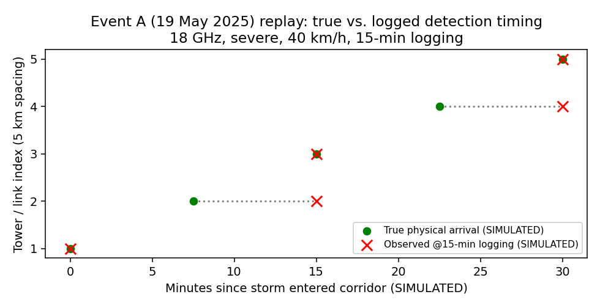
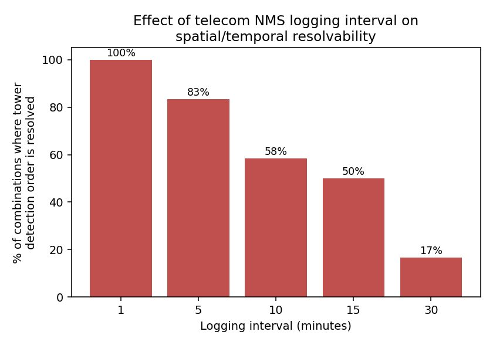
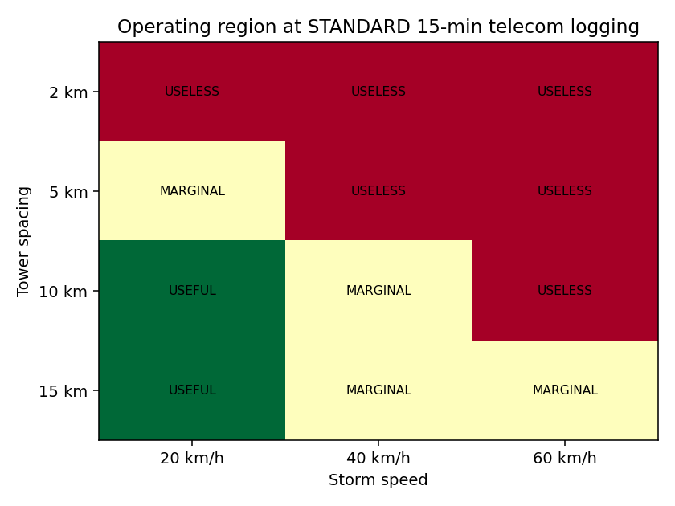

# Signal in the Static
**Early detection of severe dust storms on Makkah Region highways using existing telecom microwave/mmWave links — a simulation-based feasibility study.**

*sustainability thon 2026*

> **Status: simulation prototype.** No real telecom data was used. Nothing here is an operational system, and nothing here predicts storm formation. It is a computational test of whether the idea is worth piloting, and under what engineering conditions it breaks.

---

## The idea in 3 lines
1. Airborne dust attenuates point-to-point microwave/mmWave signals by a measurable amount (field-measured in Saudi Arabia, Sudan and Libya).
2. Telecom backhaul links already run beside many highways and their operators already log received signal level (RSL).
3. If several adjacent links degrade in sequence, the timing could give **early detection + short-lead nowcasting** (direction, speed, next affected road segment) for a **severe** dust event — as a *complement* to NCM bulletins and satellite imagery, not a replacement.

## What the simulation found (all computed by the code in `src/`)
| Finding | Result |
|---|---|
| Grid size | 900 combinations (5 frequencies × 4 spacings × 3 storm speeds × 3 severities × 5 logging intervals) |
| Detection at a 5 dB threshold | light dust **30%**, moderate **70%**, severe **95%** of combinations |
| Tower detection order preserved, by logging interval | 1 min **100%** · 5 min **83%** · 10 min **58%** · 15 min **50%** · 30 min **17%** |
| Event A replay (5 km spacing, 40 km/h, 15-min logging) | true arrivals 0 / 7.5 / 15 / 22.5 / 30 min → logged 0 / 15 / 15 / 30 / 30 min (two pairs of towers become indistinguishable) |
| Minimum useful configuration at standard 15-min logging | spacing ≥ 10 km with slow storms; tighter spacing needs 1–5 min logging |

**Headline:** severe-storm detection is physically strong; the limiting factor is the telecom logging interval and tower spacing, not the physics.





## Real vs. simulated — what is what
| Label | Meaning | Examples here |
|---|---|---|
| **REAL** | Taken from a public source | Dates, governorates and corridor of three NCM dust events (via SPA); published attenuation measurements |
| **DERIVED** | Arithmetic on a real value | 16 dB / 4.86 km → 3.292 dB/km (Port Sudan, 18 GHz) |
| **ASSUMPTION** | Engineering choice, not measured | Tower spacing, storm speed, 5 dB threshold, moderate = 25% and light = 5% of severe |
| **EXTRAPOLATION** | Fit stretched beyond its data | Any value above ~22 GHz |
| **SIMULATED** | Produced by this code | All signal traces, detection times, lead times |

The three NCM events (`data/events.csv`) share only the fact that dust occurred on Highway 5. Onset time and wind speed were **not found** for any of them, so the simulation is **not** independently validated per event.

## Known limitations (please read)
- **No real telecom data.** Access to RSL/TRSL logs is the biggest open dependency.
- **Attenuation model is a 2-point power law** (Haddad 9.4 GHz and Port Sudan 18 GHz, different storms). It is only numerically trustworthy ~9.4–22 GHz. Above that it is extrapolation and gives physically implausible values (≈70 dB/km at 73.5 GHz). Treat 40 and 73.5 GHz rows in the CSVs as qualitative only.
- **Severity tiers are our own assumption.** The source papers do not share a severity scale.
- **Light dust is not reliably detectable.** Claims should be limited to severe events.
- **Unmodelled:** rain/dust confusion, wind-induced antenna misalignment across several links (could mimic a moving dust front), equipment faults, adaptive modulation. The multi-link confidence table is *illustrative only* (assumed 15% fault rate), not a measured false-alarm rate.
- **Unconfirmed:** that microwave (not fiber) backhaul exists on the chosen corridor, and what logging interval Saudi operators allow.
- Numbers from Port Sudan, Haddad (1983) and Sabha were taken from abstracts and review summaries; **verify against the original papers before citing them formally.**

## Novelty, stated honestly
Not new: dust-attenuation physics; telecom-links-as-sensors; commercial-microwave-link rainfall sensing (operational in several countries).
Possibly new (as far as our search found): applying it to **road-safety nowcasting** on a named Makkah corridor. No deployed system or patent with this exact combination was found; US 9,470,818 B2 covers dust-storm detection with dedicated sensors + satellite imagery, a different mechanism.

## Run it
```bash
pip install -r requirements.txt
python src/simulate.py   # writes data/events.csv and results/*.csv
python src/plots.py      # writes figures/*.png
```
Python 3.9+. Outputs are deterministic (no randomness).

## Repository layout
```
src/model.py       attenuation model with provenance labels
src/simulate.py    corridor simulation + parameter grid + sensitivity tables
src/plots.py       figure generation
data/events.csv    three real NCM dust events (unknown fields = NOT FOUND)
results/           full_parameter_grid.csv, threshold_sensitivity.csv,
                   spacing_speed_logging_table.csv, multilink_confidence_illustrative.csv
figures/           plot1–plot8
docs/TECHNICAL_REPORT.md   method, results, limitations
```

## Proposed next step (not done)
A scoped pilot with one telecom operator on one corridor: a few real links, limited derived attenuation data, compared against NCM bulletins, satellite imagery and visibility records, to measure real false-alarm rate, missed detections and lead time.

## Sources
- NCM dust bulletins as reported by Saudi Press Agency (19 May 2025; 24 July 2024; 10 July 2025).
- Port Sudan field study, "Attenuation effect of dust storm on Port Sudan microwave signal level in comparison with some models".
- Khartoum, "Preliminary analysis of dust storm effects on microwave links measured in Khartoum".
- Southern Libya (Sabha), "Prediction of Microwave Signal Attenuation due to Dust and Sand Storms at (4-18 GHz)" and "Effect of sand and dust storms on microwave propagation signals in Southern Libya".
- "Micrometer and Millimeter Wave P-to-P Links Under Dust Storm Effects in Arid Climates", ETASR (2019).
- "Dust & Sand (DUSA) Storms Impact on LEO Satellite Microwave Radio Links" (Saudi Arabia / Sudan measurements).
- "Microwave and millimeter-wave attenuation in sand and dust storms" (2012).
- Uijlenhoet et al., "Opportunistic remote sensing of rainfall using microwave links from cellular communication networks", WIREs Water (2018).
- "A Review on Rainfall Measurement Based on Commercial Microwave Links in Wireless Cellular Networks", Sensors (2022).
- US 9,470,818 B2, "Sand and dust storm detection method".

## License
MIT — see `LICENSE`.

---

# ملخص بالعربي
**«إشارة في السكون»: كشف مبكر للعواصف الترابية الشديدة على طرق منطقة مكة المكرمة باستخدام روابط الميكروويف القائمة بين أبراج الاتصالات.**

- **الحالة:** نموذج محاكاة حاسوبية فقط. لا توجد بيانات اتصالات حقيقية، ولا يُدّعى التنبؤ بتكوّن العاصفة أو وجود نظام تشغيلي.
- **الفكرة:** الغبار الكثيف يُضعف إشارات الميكروويف بقدر قابل للقياس (موثّق في قياسات ميدانية منها الرياض). إذا تدهورت عدة روابط متجاورة بالتتابع يمكن تقدير وصول العاصفة واتجاهها وسرعتها والمقطع التالي المعرّض للخطر، كمكمّل لنشرات المركز الوطني للأرصاد والأقمار الصناعية.
- **أهم نتيجة:** الكشف عن العواصف الشديدة قوي فيزيائيًا، لكن التسجيل القياسي كل 15 دقيقة يحافظ على ترتيب اكتشاف الأبراج في 50% فقط من الحالات المحاكاة (و17% عند 30 دقيقة). الحل إما تباعد 10 كم فأكثر أو تسجيل كل 1–5 دقائق.
- **حدود مهمة:** لا بيانات حقيقية؛ النموذج موثوق رقميًا بين 9.4 و22 جيجاهرتز تقريبًا؛ الغبار الخفيف غير قابل للكشف بثقة؛ لم يُنمذج تأثير الرياح على اتجاه الهوائيات ولا الخلط مع المطر.
- **التشغيل:** `pip install -r requirements.txt` ثم `python src/simulate.py` ثم `python src/plots.py`.
